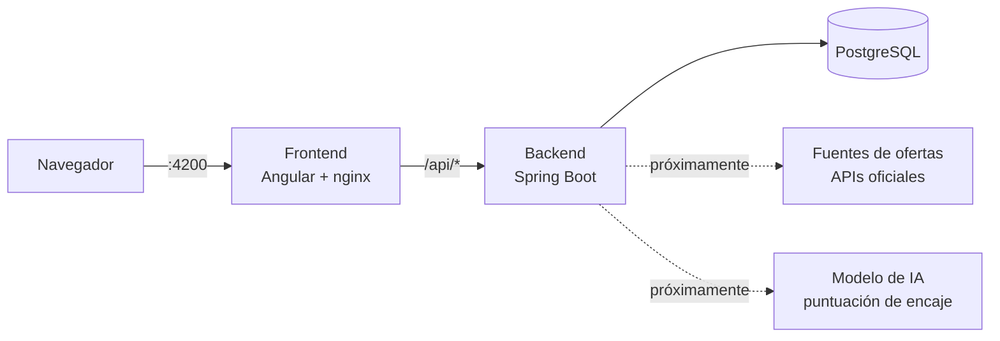

# 📡 Radar de Empleo IT

**Agregador de ofertas de empleo IT junior con puntuación de encaje por IA.**
Recoge ofertas de varias fuentes legales, las normaliza y las ordena según lo bien que encajan con mi perfil.

> 🚧 **En desarrollo activo.** Ahora mismo está terminada la base técnica del backend. Consulta el [roadmap](#-roadmap).


---

## 🎯 El problema

Buscar el primer empleo en IT es repetitivo: decenas de portales, ofertas duplicadas, muchas que no son realmente junior… y horas leyendo descripciones para descubrir que no encajan.

**Radar de Empleo IT** junta las ofertas en un único sitio, elimina duplicados y usa un modelo de IA para puntuar cada una frente a mi perfil, **explicando por qué** encaja o no.

## 🧭 Cómo se está construyendo: Spec-Driven Development

Lo que más me interesa enseñar de este proyecto es **el proceso**, no solo el código.

Lo desarrollo con **Spec-Driven Development (SDD)**: **yo tomo las decisiones y la IA ([Claude Code](https://code.claude.com)) implementa**, siempre a partir de documentos aprobados.

```
Constitución → Spec (QUÉ) → Plan (CÓMO) → Tareas (PASOS) → Implementación → Revisión
```

| Artefacto | Qué es | Dónde |
|---|---|---|
| **Constitución** | Principios no negociables del proyecto (stack, calidad, seguridad, legalidad) | [`docs/constitution.md`](docs/constitution.md) |
| **ADRs** | Cada decisión de arquitectura, con las opciones que descarté y por qué | [`docs/adr/`](docs/adr/) |
| **Specs** | Qué debe hacer cada funcionalidad, con criterios de aceptación comprobables | [`specs/`](specs/) |
| **Plan y tareas** | Cómo se construye y en qué pasos pequeños y verificables | `specs/NNN-*/plan.md` y `tasks.md` |
| **Skill `/tarea`** | Automatiza el flujo con la IA: comprobaciones previas, implementación acotada, informe y commit **solo tras mi revisión** | [`.claude/skills/tarea/`](.claude/skills/tarea/SKILL.md) |

Reglas que sigo:
- **No se escribe código sin una spec aprobada.**
- **Cada tarea se revisa y se comprueba antes del commit**, incluido ver los tests fallar a propósito.
- **Si la realidad no coincide con el plan, se corrige el documento** y queda anotado en su historial.
- El historial de commits ([Conventional Commits](https://www.conventionalcommits.org/es/)) cuenta la historia del proyecto paso a paso.

## 🏗️ Arquitectura



- **Monorepo** con `backend/` y `frontend/`; todo el sistema arranca con un único `docker compose up`.
- **nginx** sirve el frontend y actúa como *reverse proxy* de `/api` hacia el backend: mismo origen para el navegador, así que no hace falta CORS.
- **Arquitectura de conectores:** cada fuente de ofertas implementa una interfaz común y se activa por configuración. Si un conector falla, los demás siguen.

## 🛠️ Stack

| Capa | Tecnología |
|---|---|
| Backend | Java 25 (LTS), Spring Boot 4.1, Maven Wrapper, Spring Boot Actuator |
| Frontend | Angular 22 (standalone), nginx |
| Base de datos | PostgreSQL 18 |
| Tests | JUnit 5, Testcontainers (PostgreSQL real en los tests de integración) |
| Infraestructura | Docker (imágenes multi-etapa), Docker Compose |
| CI | GitHub Actions |
| Desarrollo con IA | Claude Code + skill propia para el flujo SDD |

## 🧩 Decisiones destacadas

Todas están documentadas como ADR, con alternativas y consecuencias:

- **[ADR-0002](docs/adr/0002-politica-fuentes-legal.md): solo fuentes 100 % legales.** Únicamente APIs oficiales y feeds públicos. Nada de scraping de portales que lo prohíben. Por eso el repositorio puede ser público.
- **[ADR-0004](docs/adr/0004-versiones-stack.md): stack en versiones LTS y estables actuales** (Java 25, Spring Boot 4, Angular 22). Al ser un proyecto nuevo, no tiene sentido empezar con deuda técnica.
- **[ADR-0006](docs/adr/0006-frontend-nginx.md): frontend servido con nginx** en Docker, como en producción, en vez del servidor de desarrollo.
- **[ADR-0007](docs/adr/0007-skill-tarea.md): skill `/tarea`** para estandarizar el trabajo con la IA sin perder la revisión humana.

Algunos detalles de seguridad y calidad:
- El endpoint de salud expone **solo** `health` de Actuator y muestra el estado de cada componente **sin detalles internos**.
- **Ningún secreto en el repositorio:** credenciales por variables de entorno (`.env` ignorado, `.env.example` documentado). La app falla al arrancar si falta configuración (*fail fast*).
- Imágenes Docker **multi-etapa**, con **versiones fijas** y ejecución con **usuario sin privilegios**.

## 🚀 Cómo arrancarlo

**Requisitos:** [Docker Desktop](https://www.docker.com/products/docker-desktop/).

```bash
# 1. Variables de entorno (cambia la contraseña en .env)
cp .env.example .env          # en Windows: copy .env.example .env

# 2. Levantar base de datos y backend
docker compose up --build db backend
```

Comprueba que funciona: **http://localhost:8080/api/health** → `"status": "UP"`, con la base de datos en `UP`.

> Las instrucciones completas, con frontend incluido, se añadirán al terminar la spec 000.

### Tests del backend

```bash
cd backend
./mvnw verify      # requiere Docker abierto (Testcontainers arranca un PostgreSQL real)
```

## 📁 Estructura

```
radar-empleo-it/
├── backend/            # Spring Boot
├── frontend/           # Angular (en curso)
├── docker-compose.yml
├── .env.example
├── docs/
│   ├── constitution.md
│   └── adr/            # Decisiones de arquitectura
├── specs/              # Una carpeta por funcionalidad: spec, plan y tareas
└── .claude/skills/     # Skill /tarea para Claude Code
```

## 🗺️ Roadmap

- [ ] **Spec 000: esqueleto**
  - [x] Backend con endpoint de salud y test de integración
  - [x] Docker Compose con PostgreSQL y backend
  - [ ] Frontend Angular con página de estado
  - [ ] CI con GitHub Actions
- [ ] **Spec 001:** modelo de oferta normalizado y primer conector (Jobicy)
- [ ] Conector InfoJobs (API oficial) y deduplicación entre fuentes
- [ ] Puntuación de encaje con IA, con explicación de motivos
- [ ] Listado de ofertas con filtros y orden por encaje
- [ ] Demo en vídeo

## 👤 Autor

**Juan Francisco Morales Plaza**, desarrollador full stack junior (Java/Spring Boot, Angular, PostgreSQL, Docker).

- GitHub: [@Juanfranciscomp30](https://github.com/Juanfranciscomp30)
- LinkedIn: https://www.linkedin.com/in/juan-francisco-morales-plaza/

¿Te interesa el proyecto o mi perfil? Escríbeme por LinkedIn.