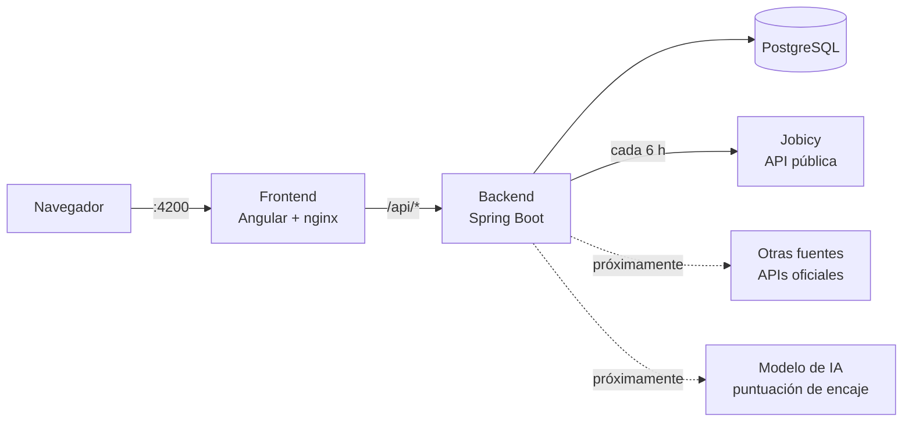

# 📡 Radar de Empleo IT

**Agregador de ofertas de empleo IT junior con puntuación de encaje por IA.**
Recoge ofertas de varias fuentes legales, las normaliza y las ordena según lo bien que encajan con mi perfil.

> 🚧 **En desarrollo activo.** Ya recoge ofertas IT reales de [Jobicy](https://jobicy.com) y las muestra en un listado; la puntuación con IA es lo siguiente. Consulta el [roadmap](#-roadmap).

[](https://github.com/Juanfranciscomp30/radar-empleo-it/actions/workflows/ci.yml)


---

## 🎯 El problema

Buscar el primer empleo en IT es repetitivo: decenas de portales, ofertas duplicadas, muchas que no son realmente junior… y horas leyendo descripciones para descubrir que no encajan.

**Radar de Empleo IT** junta las ofertas en un único sitio, elimina duplicados y usa un modelo de IA para puntuar cada una frente a mi perfil, **explicando por qué** encaja o no.

## 🧭 Cómo se está construyendo: Spec-Driven Development

Lo que más me interesa enseñar de este proyecto es **el proceso**, no solo el código.

Lo desarrollo con **Spec-Driven Development (SDD)**: **yo tomo las decisiones y la IA ([Claude Code](https://code.claude.com)) implementa**, siempre a partir de documentos aprobados.

```
Constitución → Spec (QUÉ) → Plan (CÓMO) → Tareas (PASOS) → Implementación → Revisión
```

| Artefacto | Qué es | Dónde |
|---|---|---|
| **Constitución** | Principios no negociables del proyecto (stack, calidad, seguridad, legalidad) | [`docs/constitution.md`](docs/constitution.md) |
| **ADRs** | Cada decisión de arquitectura, con las opciones que descarté y por qué | [`docs/adr/`](docs/adr/) |
| **Specs** | Qué debe hacer cada funcionalidad, con criterios de aceptación comprobables | [`specs/`](specs/) |
| **Plan y tareas** | Cómo se construye y en qué pasos pequeños y verificables | `specs/NNN-*/plan.md` y `tasks.md` |
| **Skill `/tarea`** | Automatiza el flujo con la IA: comprobaciones previas, implementación acotada, informe y commit **solo tras mi revisión** | [`.claude/skills/tarea/`](.claude/skills/tarea/SKILL.md) |

Reglas que sigo:
- **No se escribe código sin una spec aprobada.**
- **Cada tarea se revisa y se comprueba antes del commit**, incluido ver los tests fallar a propósito.
- **Si la realidad no coincide con el plan, se corrige el documento** y queda anotado en su historial.
- El historial de commits ([Conventional Commits](https://www.conventionalcommits.org/es/)) cuenta la historia del proyecto paso a paso.

## 🏗️ Arquitectura



- **Monorepo** con `backend/` y `frontend/`; todo el sistema arranca con un único `docker compose up`.
- **nginx** sirve el frontend y actúa como *reverse proxy* de `/api` hacia el backend: mismo origen para el navegador, así que no hace falta CORS.
- **Arquitectura de conectores:** cada fuente de ofertas implementa una interfaz común y se activa por configuración. Si un conector falla, los demás siguen.

### Qué hace ahora

1. **Ingesta:** al arrancar y después cada 6 horas, el backend descarga ofertas de *Software Engineering* de Jobicy con **una sola llamada** (uso justo) y se queda con las abiertas a candidatos en España: `Spain`, `Europe`, `EMEA` o `Anywhere`.
2. **Normalización:** cada conector traduce sus ofertas a un modelo común (título, empresa, ubicación, fecha, URL, jornada, nivel, salario…) y se guardan en PostgreSQL **sin duplicados**: la base de datos lo garantiza con una restricción única por fuente e identificador.
3. **API:** `GET /api/ofertas?pagina=0&tamano=20` devuelve las ofertas de la más reciente a la más antigua, paginadas (máximo 50 por página).
4. **Web:** listado en tarjetas con título, empresa, ubicación, antigüedad ("hace 2 días") y un botón **Ver oferta** que abre la oferta original. Muestra mensajes claros si todavía no hay ofertas o si el servidor no responde.

Si Jobicy falla o no responde, el error queda en el log y la web sigue mostrando lo ya guardado.

## 🛠️ Stack

| Capa | Tecnología |
|---|---|
| Backend | Java 25 (LTS), Spring Boot 4.1, Spring Data JPA, Flyway, Maven Wrapper, Spring Boot Actuator |
| Frontend | Angular 22 (standalone), nginx |
| Base de datos | PostgreSQL 18 |
| Tests | Backend: JUnit 5 y Testcontainers (PostgreSQL real en los tests de integración). Frontend: Vitest |
| Infraestructura | Docker (imágenes multi-etapa), Docker Compose |
| CI | GitHub Actions: compila y testea backend y frontend y construye las imágenes en cada push y pull request |
| Desarrollo con IA | Claude Code + skill propia para el flujo SDD |

## 🧩 Decisiones destacadas

Todas están documentadas como ADR, con alternativas y consecuencias:

- **[ADR-0002](docs/adr/0002-politica-fuentes-legal.md): solo fuentes 100 % legales.** Únicamente APIs oficiales y feeds públicos. Nada de scraping de portales que lo prohíben. Por eso el repositorio puede ser público.
- **[ADR-0004](docs/adr/0004-versiones-stack.md): stack en versiones LTS y estables actuales** (Java 25, Spring Boot 4, Angular 22). Al ser un proyecto nuevo, no tiene sentido empezar con deuda técnica.
- **[ADR-0006](docs/adr/0006-frontend-nginx.md): frontend servido con nginx** en Docker, como en producción, en vez del servidor de desarrollo.
- **[ADR-0007](docs/adr/0007-skill-tarea.md): skill `/tarea`** para estandarizar el trabajo con la IA sin perder la revisión humana.
- **[ADR-0010](docs/adr/0010-persistencia-jpa.md): Spring Data JPA** como capa de persistencia, con una tabla sin relaciones y la idempotencia delegada en la base de datos (`INSERT … ON CONFLICT DO NOTHING`).
- **[ADR-0011](docs/adr/0011-migraciones-flyway.md): Flyway** para versionar el esquema; Hibernate solo lo valida, nunca lo modifica.
- **[ADR-0012](docs/adr/0012-programacion-ingesta.md): ingesta con `@Scheduled`** cada 6 horas y al arrancar. El disparo manual existe solo detrás de un *flag* desactivado por defecto, para que nadie pueda provocar llamadas abusivas a la API de un tercero.

Algunos detalles de seguridad y calidad:
- El endpoint de salud expone **solo** `health` de Actuator y muestra el estado de cada componente **sin detalles internos**.
- **Ningún secreto en el repositorio:** credenciales por variables de entorno (`.env` ignorado, `.env.example` documentado). La app falla al arrancar si falta configuración (*fail fast*).
- Imágenes Docker **multi-etapa**, con **versiones fijas** y ejecución con **usuario sin privilegios**.

## 🚀 Cómo arrancarlo

**Requisito:** [Docker Desktop](https://www.docker.com/products/docker-desktop/) abierto. No hace falta instalar Java ni Node para ejecutar la aplicación.

```bash
# 1. Clonar el repositorio
git clone https://github.com/Juanfranciscomp30/radar-empleo-it.git
cd radar-empleo-it

# 2. Variables de entorno (cambia la contraseña en .env)
cp .env.example .env          # en Windows: copy .env.example .env

# 3. Levantar todo el sistema (frontend, backend y PostgreSQL)
docker compose up --build
```

La primera vez tarda unos minutos porque descarga imágenes y compila. Cuando termine:

| URL | Qué deberías ver |
|---|---|
| **http://localhost:4200** | El listado de ofertas en tarjetas, el estado del backend (**Conectado**) y, en el pie, "Ofertas remotas de Jobicy" |
| **http://localhost:8080/api/ofertas** | Las ofertas guardadas en JSON, de la más reciente a la más antigua |
| **http://localhost:8080/api/health** | `"status": "UP"`, con la base de datos (`db`) en `UP` |

La primera ingesta se hace al arrancar el backend; en el log (`docker compose logs backend`) aparece una línea como `Ingesta de jobicy: 14 nuevas, 0 existentes`. Si la web dice "Todavía no hay ofertas", espera unos segundos y recarga.

Para pararlo: `Ctrl+C`, o `docker compose down` si lo arrancaste en segundo plano con `-d`. Los datos de PostgreSQL se guardan en un volumen y no se pierden al parar.

### Variables de entorno

Se leen de `.env` (copia de [`.env.example`](.env.example)), que nunca se sube al repositorio.

| Variable | Para qué | Valor por defecto |
|---|---|---|
| `POSTGRES_DB`, `POSTGRES_USER`, `POSTGRES_PASSWORD` | Base de datos; el backend usa las mismas | `radar`, `radar`, *(cámbiala)* |
| `RADAR_INGESTA_MANUAL_HABILITADA` | `true` habilita `POST /api/ingestas` para lanzar una ingesta a mano en pruebas. Sin ella, la ruta responde `404` | `false` |

Para probar la ingesta manual: pon `RADAR_INGESTA_MANUAL_HABILITADA=true` en `.env`, ejecuta `docker compose up -d backend` (un `restart` no relee `.env`) y lanza `curl -X POST http://localhost:8080/api/ingestas`. Responde `202` con un resumen por fuente; la segunda vez, `nuevas: 0`, porque no se duplican ofertas. **Vuelve a ponerla a `false` al terminar.**

> **Puertos ocupados:** el sistema usa los puertos 4200, 8080 y 5432. Si alguno está en uso (por ejemplo, un `npm start` olvidado en el 4200), cierra ese programa antes de arrancar.

### Desarrollar el frontend

Para trabajar en Angular con recarga automática, el frontend se ejecuta fuera de Docker y el backend dentro. Requiere [Node.js](https://nodejs.org/) 24.

```bash
# Terminal 1: base de datos y backend en Docker
docker compose up db backend

# Terminal 2: servidor de desarrollo de Angular
cd frontend
npm ci
npm start
```

Abre **http://localhost:4200**. Las llamadas a `/api` se redirigen al backend gracias a [`proxy.conf.json`](frontend/proxy.conf.json). No arranques a la vez el servicio `frontend` de Docker, porque usa el mismo puerto.

### Tests

```bash
# Backend (requiere Docker abierto: Testcontainers arranca un PostgreSQL real; necesita JDK 25)
cd backend
./mvnw verify          # en Windows: .\mvnw verify

# Frontend
cd frontend
npm ci
npx ng test --watch=false
```

Los tests **nunca llaman a internet**: el conector de Jobicy se prueba con respuestas reales guardadas como *fixtures* y un servidor HTTP simulado.

Los mismos comandos se ejecutan en [GitHub Actions](.github/workflows/ci.yml) en cada push a `main` y en cada pull request.

## 📁 Estructura

```
radar-empleo-it/
├── backend/            # Spring Boot
├── frontend/           # Angular + nginx
├── docker-compose.yml
├── .env.example
├── .github/workflows/  # CI con GitHub Actions
├── docs/
│   ├── constitution.md
│   └── adr/            # Decisiones de arquitectura
├── specs/              # Una carpeta por funcionalidad: spec, plan y tareas
└── .claude/skills/     # Skill /tarea para Claude Code
```

## 🗺️ Roadmap

- [x] **Spec 000: esqueleto**
  - [x] Backend con endpoint de salud y test de integración
  - [x] Docker Compose con PostgreSQL y backend
  - [x] Frontend Angular con página de estado, servido con nginx
  - [x] CI con GitHub Actions
  - [x] README con instrucciones de arranque

### MVP (23/11)

- [x] **Spec 001: ofertas reales de Jobicy**
  - [x] Modelo de oferta normalizado, tabla con Flyway y guardado sin duplicados
  - [x] Arquitectura de conectores y conector de Jobicy (filtro de industria y región)
  - [x] Ingesta programada cada 6 h, al arrancar y manual tras un *flag*
  - [x] API paginada `GET /api/ofertas`
  - [x] Listado de ofertas en tarjetas, con atribución a Jobicy
- [ ] Puntuación de encaje con IA, con explicación de motivos
- [ ] Listado de ofertas ordenado por encaje
- [ ] Demo en vídeo

### Fase 2

- [ ] Conector InfoJobs (API oficial) y otros conectores
- [ ] Deduplicación entre fuentes
- [ ] Filtros y búsqueda en el listado

## 👤 Autor

**Juan Francisco Morales Plaza**, desarrollador full stack junior (Java/Spring Boot, Angular, PostgreSQL, Docker).

- GitHub: [@Juanfranciscomp30](https://github.com/Juanfranciscomp30)
- LinkedIn: https://www.linkedin.com/in/juan-francisco-morales-plaza/

¿Te interesa el proyecto o mi perfil? Escríbeme por LinkedIn.